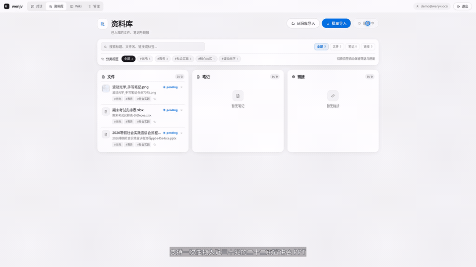
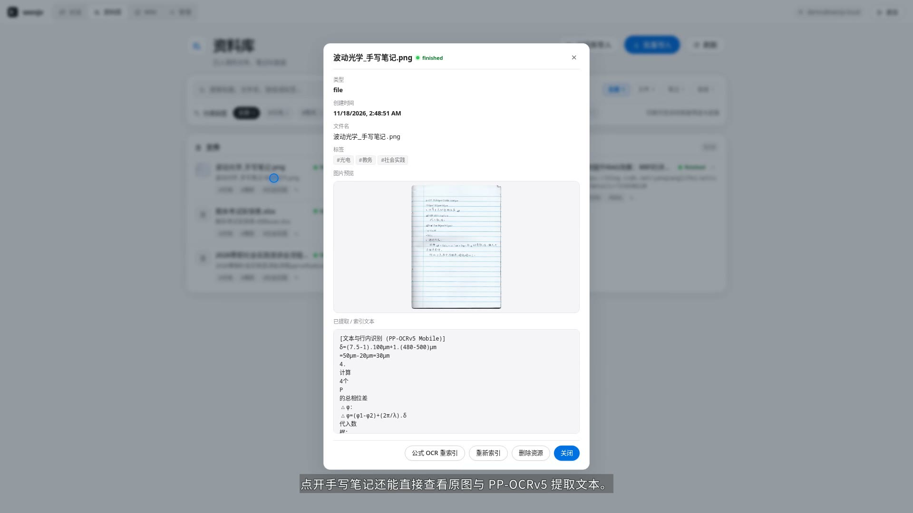
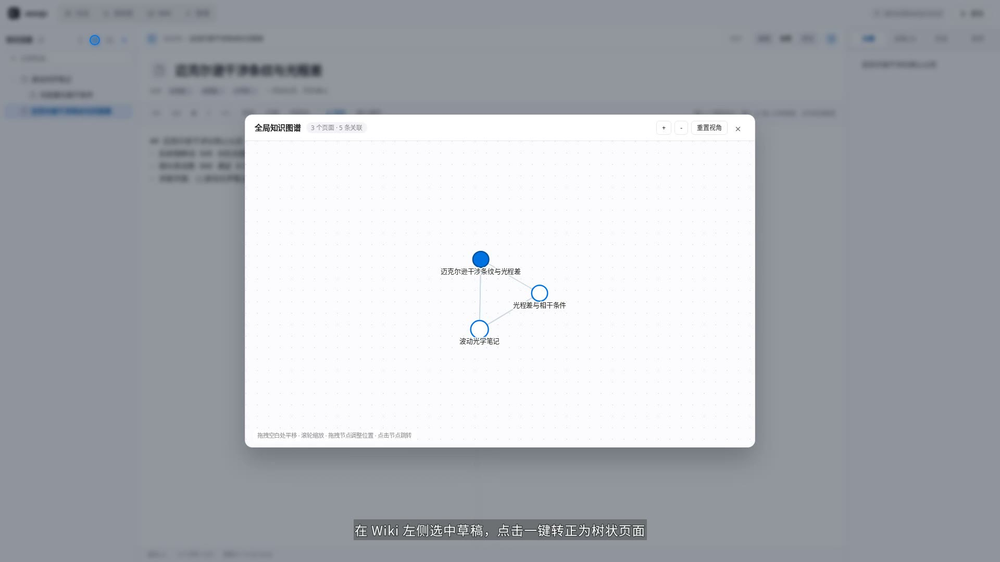
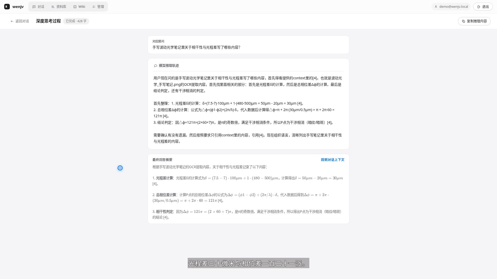

# wenjv（问据）

**面向个人与小团队的自托管多模态知识库与可信 RAG 系统** —— 统一收录 PDF / PPTX / 原生 Excel / 网页链接 / 手写公式图片 / Markdown 笔记，通过本地 ONNX 多路混合检索、可溯源流式问答、证据不足拒答，以及「收件箱 ↔ 树状 Wiki」双向知识网络，彻底解决个人知识管理冷启动难与大模型“凭空编造”的痛点。

[]()
[]()
[]()

> **分支说明**：`main` 分支仅保留当前主力 TypeScript 全栈版本（[`wenjv-ts/`](./wenjv-ts/)）；早期 Python FastAPI + Vue 原型已完整归档至 [`python-v1`](https://github.com/danzeyanan/wenjv/tree/python-v1) 分支。

---

## 🎬 完整产品与工程演示视频

点击下方动图可直接查看或下载 **`1080p` 完整有声演示视频**（04:10，涵盖多文件批量导入、CSDN 网页抓取、收件箱转正 Wiki 图谱、Excel / 手写公式 KaTeX 问答、无依据拒答、SigLIP2 以图搜图与 `/admin` 监控）：

[](https://github.com/danzeyanan/wenjv/raw/main/docs/media/wenjv-demo.mp4)

> 📺 **完整视频文件**：[`docs/media/wenjv-demo.mp4`](./docs/media/wenjv-demo.mp4)（`14 MB`，`1920×1080`，H.264/AAC）。  
> *提示：由于 GitHub 限制 Git 直接推送 `<video>` 标签，如需在 GitHub 页面内直接嵌出原生带声音播放器，可在 GitHub 网页端点击编辑本 `README.md` 并将本地 `wenjv-demo.mp4` 直接拖入编辑框生成 `user-attachments` 链接。*

---

## ✨ 核心特性

- **零结构负担的「收件箱 → 树状 Wiki」双通道**
  - 先用低门槛「收件箱」随手收集灵感草稿，再在 Wiki 页面侧边栏或资料库弹窗中**一键转正为树状 Wiki**（自动继承标签与附件）。
  - 原生支持 `[[双链]]`、反向链接、交互式全局知识图谱、版本号乐观锁防并发覆盖、历史版本行级对比回滚，以及自动过滤模型思考块（`<think>`）的文档辅助 Copilot。
- **全格式多源解析与本地 CPU 理工科识图**
  - 支持批量上传 `pdf` / `docx` / `pptx` / 原生 `.xlsx` 表格 / `md` / `txt` / `csv` / `json` / `html` 与图片，内置 RFC-5987 中文文件名兼容与 `50 MB` 大文件直传。
  - 支持网页 URL 正文抽取并校验 SSRF 私网地址拦截。
  - 独立 Python Sidecar（`8788`）集成 **PP-OCRv5 Mobile + Pix2Text**，将图片中的手写物理/数学公式转为 LaTeX 入库，并在对话区与思考页通过 **KaTeX** 规范渲染。
- **本地多模态混合检索与可信防幻觉交互**
  - 基于本地 **ONNX Runtime** 运行 `BGE-M3` 向量检索 + SQLite `FTS5` 关键词检索 + RRF 融合 + `BGE-Reranker` 二阶段精排 + `SigLIP2` 768 维以图搜图（含自动算子精度降级）。
  - 证据不足时主动拒答，每条回答均附带逐条原文引用；深度思考过程折叠收纳至二级详情页 `/thinking/:id`，主对话区保持干净简洁；通过 `KeepAlive + Pinia` 实现切换导航栏不丢对话与输入进度。
- **免 Redis 持久化队列与上线前安全加固**
  - 基于 SQLite 事务队列实现 6 路并发入库、失败自动重试、超时僵死任务恢复及内容时间戳缓存自动失效。
  - 完成多租户三层物理隔离、SSRF 拦截、危险文件（HTML/SVG 等）强制降级下载防 XSS、登录限流及 `/admin` 观测台。

---

## 🖼️ 界面预览

| 资料库入库与手写公式 OCR 解析 | Wiki 树状知识库与全局关系图谱 | 多模态溯源问答与 KaTeX 公式页 |
| :---: | :---: | :---: |
|  |  |  |

---

## 📊 检索基准评测（Open RAGBench）

在 **Open RAGBench**（51 篇 ArXiv 论文、6,532 个切片、55 道图文表混合题）上执行全链路消融评测（[`wenjv-ts/tools/eval-openragbench.ts`](./wenjv-ts/tools/eval-openragbench.ts)）：

| 评测阶段 | 文档级 Recall@5 | 文档级 MRR@5 | 单题平均检索耗时 | 端到端闭环表现 |
| :--- | :---: | :---: | :---: | :--- |
| 优化前（长问句 FTS5 匹配过严） | — | `0.465`（无精排） | — | 复杂长句易在关键词路漏召回 |
| **修复后（FTS5 OR 子句重构 + 去掉 MMR）** | **`100%`（55/55）** | **`1.00`**（开关精排均达标） | **`1.67 s`** | 云端生成答对 **`94.5%`（52/55）**，证据不足主动拒答 2 题 |

---

## 🚀 快速开始（3 步启动）

更多配置、环境变量与部署细节请见 [`wenjv-ts/docs/USER_GUIDE.md`](./wenjv-ts/docs/USER_GUIDE.md) 与 [`wenjv-ts/docs/ARCHITECTURE.md`](./wenjv-ts/docs/ARCHITECTURE.md)。

### 1. 安装依赖、下载模型与准备配置

> 全流程使用跨平台 Node.js 脚本，**Windows（PowerShell / CMD）、macOS 与 Linux** 均可直接执行相同命令。

```bash
cd wenjv-ts
pnpm install --frozen-lockfile

# 一键下载并校验全部本地模型（检索 BGE-M3 / BGE-Reranker / SigLIP2 + OCR PP-OCRv5 / Pix2Text）
pnpm run download-models
# 可选参数：仅下载 OCR（-- --only ocr）或跳过 OCR（-- --no-ocr）
# 国内网络可使用代理或自定义镜像加速：
#   Linux / macOS:       WENJV_GITHUB_PROXY=https://gh-proxy.com/ pnpm run download-models
#   Windows PowerShell:  $env:WENJV_GITHUB_PROXY="https://gh-proxy.com/"; pnpm run download-models
#   自定义镜像基地址:     pnpm run download-models -- --base-url https://your-mirror.example.com/wenjv-models

# 如需开启本地 OCR / 手写公式识别 Sidecar（可选，推荐；模型已由上方 download-models 自动就位）
python3 -m venv sidecar/.venv
sidecar/.venv/bin/pip install ./sidecar          # Windows: sidecar\.venv\Scripts\pip install ./sidecar

# 复制环境变量模板并填写 CHAT_API_KEY / JWT_SECRET
# 默认配置路径：~/.config/wenjv/backend.env（Windows 为 %USERPROFILE%\.config\wenjv\backend.env）
mkdir -p ~/.config/wenjv
cp .env.example ~/.config/wenjv/backend.env
```

### 2. 单端口生产模式启动

```bash
cd wenjv-ts
pnpm start              # 跨平台一键启动（自动构建前端，缺模型时交互提示下载）
# bash scripts/start-prod.sh   # Linux / WSL 亦可继续使用原 bash 入口
```

浏览器访问 `http://127.0.0.1:8787`（Node 服务单端口同时托管 Vue 3 前端与 API，运行时数据默认存储于 `~/.config/wenjv`）。

### 3. Docker Compose 启动（可选）

```bash
# 确保本地 ./models 含 ONNX 模型且 ~/.config/wenjv/backend.env 已配置
docker compose up -d --build
```

---

## 🧪 自动化验证与目录导航

```bash
cd wenjv-ts
pnpm run verify       # 快速门禁：no-stubs 检查 + TypeScript 类型检查 + Vitest 48 项单测
pnpm run verify:all   # 全量验收：含前端构建、OCR Sidecar 实测与 Playwright E2E
```

| 路径 | 说明 |
| :--- | :--- |
| [`wenjv-ts/`](./wenjv-ts/) | 主力 TypeScript 全栈系统（Hono 服务端、Vue 3 SPA、OCR Sidecar、Playwright E2E） |
| [`wenjv-ts/docs/ARCHITECTURE.md`](./wenjv-ts/docs/ARCHITECTURE.md) | Schema v2、接口总览与系统架构文档 |
| [`wenjv-ts/docs/USER_GUIDE.md`](./wenjv-ts/docs/USER_GUIDE.md) | 环境安装、配置项说明与验收手册 |
| [`docs/media/`](./docs/media/) | 演示视频（`.mp4`）、预览动图（`.gif`）与核心功能截图 |
| [`Dockerfile`](./Dockerfile) / [`docker-compose.yml`](./docker-compose.yml) | 适配 `wenjv-server`（`8787`）与 `wenjv-sidecar`（`8788`）的容器编排 |
| `python-v1` 分支 | 早期 Python FastAPI + Vue 原型历史归档（[`tree/python-v1`](https://github.com/danzeyanan/wenjv/tree/python-v1)） |
